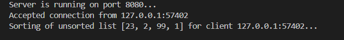
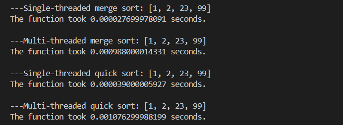

# Client-Server Sorting App

TCP client-server application in Python. Clients send a list of numbers to the server and the server sorts it with merge sort and quick sort, each in a single-threaded and a multi-threaded version. After that the server sends back the results with the time each version took.

## Features

- The server serves many clients at the same time, each one in its own thread
- Four sorting versions: single-threaded and multi-threaded versions of merge sort and quick sort
- The time of every sorting version is measured and sent to the client
- The number of elements, the elements and the number of threads are checked with a message for every mistake
- Type `exit` at any prompt to disconnect or `restart` to start over
- When a session ends, the client can start a new one without restarting the program

## Example





## Running

Requires Python 3.7 or newer. Only the standard library is used (`socket`, `threading`, `time`, `os`), so there is nothing to install.

Start the server:

```bash
python server.py
```

Then start one or more clients, each in its own terminal:

```bash
python client.py
```

The server listens on `127.0.0.1:8080`, so the client must run on the same computer. To accept clients from other computers, change the address in `server.bind` to `0.0.0.0` and the address in `client.py` to the IP address of the server.

## How it works

- Every message ends with a new line. Both sides read until the new line, because TCP does not keep the borders between messages.
- The server asks the questions and the client only shows them and sends back what the user types.
- The multi-threaded versions split the list into as many parts as there are threads, sort every part in its own thread and then merge the sorted parts.

## Why the multi-threaded versions are not faster

In Python only one thread can run Python code at a time, because of the Global Interpreter Lock. Threads help when the work waits for the network or the disk, which is why the server uses one thread per client. Sorting is pure computation, so the sorting threads take turns instead of running at the same time, and creating and joining the threads makes the multi-threaded versions slower. Real parallel sorting in Python needs separate processes with `multiprocessing`. 

## Project structure

```
server.py       sorting algorithms, questions to the client, one thread per client
client.py       connects to the server, shows its messages and sends the user's answers
```

## Possible improvements

- Use `multiprocessing` for the multi-threaded versions, so that they really run in parallel.
- Let the server generate large random lists, where the difference in time between the versions becomes visible.